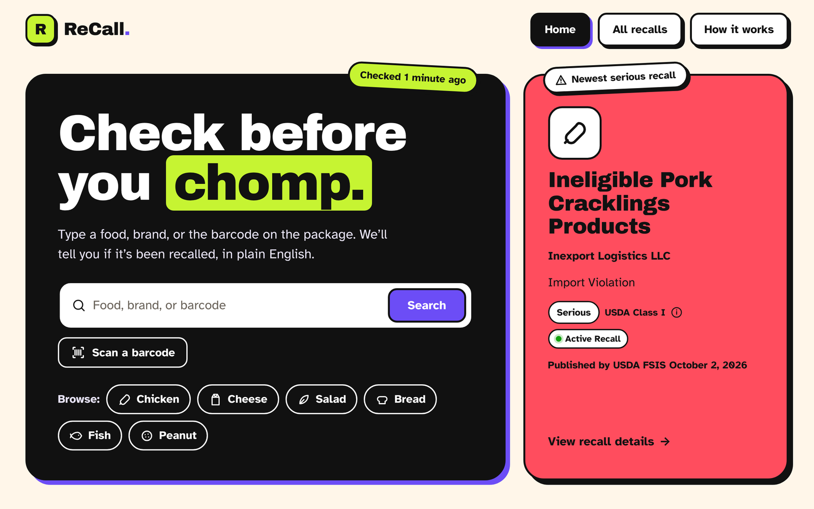
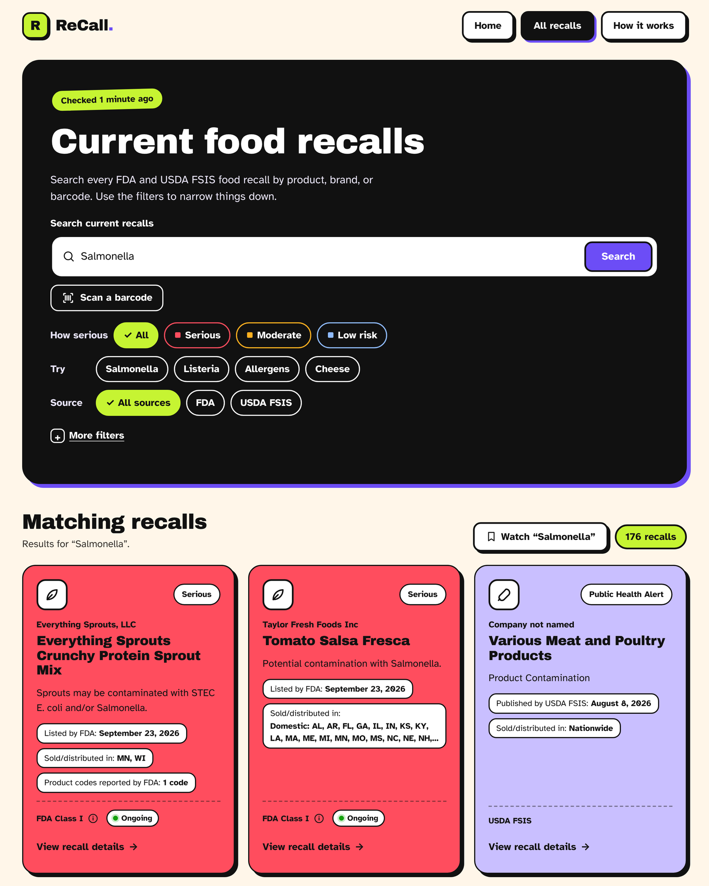
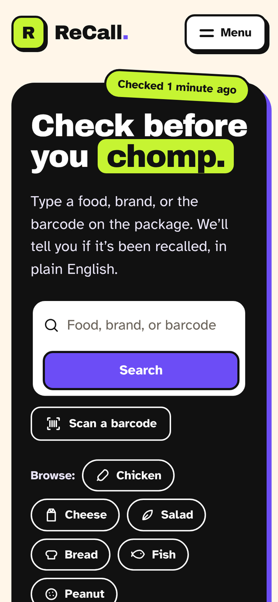
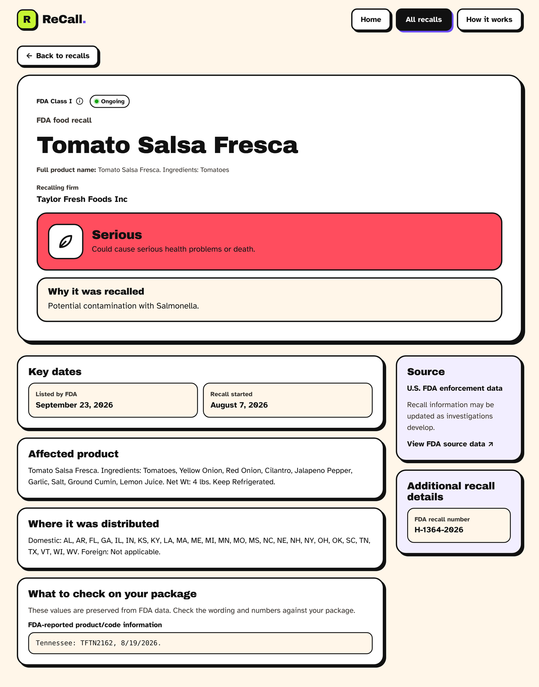
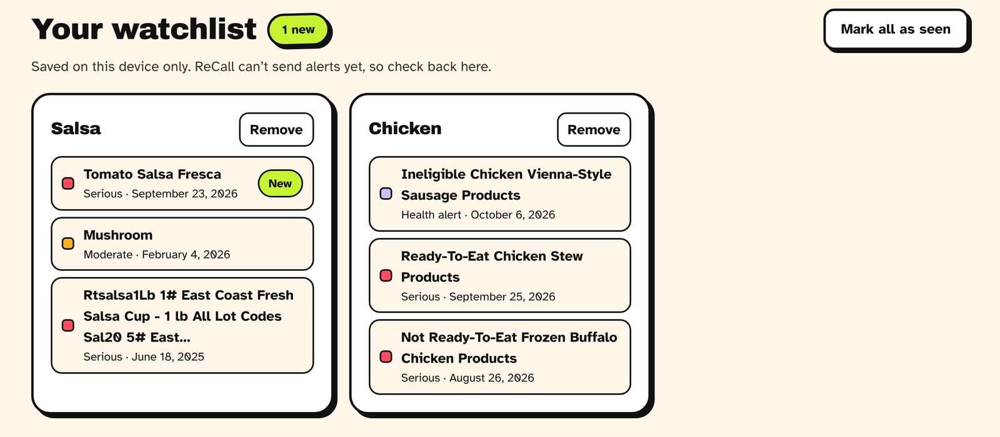

# ReCall

**Check before you chomp.** ReCall makes U.S. food safety recalls easy to search and understand. Type a food, a brand, or the barcode on the package, and it tells you whether that product has been recalled and how serious it is, in plain English.

It pulls official records from the **FDA** (food enforcement reports) and **USDA FSIS** (meat, poultry, and egg recalls and Public Health Alerts). It keeps the raw source data and serves a cleaned-up version through an API and a web app.



## Features

### For people checking their food

- **One search box.** Search by product name, brand or company, recall reason (e.g. "Salmonella"), or UPC.
- **Barcode scanning.** Tap "Scan a barcode" to read a UPC/EAN with your phone or laptop camera and search for it. This works on iOS Safari too. If camera access is blocked, the app explains how to type the code instead.
- **Plain-language severity.** Recalls are color-coded as Serious, Moderate, or Low risk. The official FDA/USDA class is shown in small print.
- **Filters.** Filter by how serious it is, source (FDA or USDA FSIS), status, and record type (recall or public health alert). Quick-search chips cover common searches.
- **Watchlist.** Save a search (a brand, product, or barcode). The home page shows its newest matches and flags anything listed since your last visit. The watchlist is stored in your browser only, and the UI says plainly that ReCall doesn't send alerts yet.
- **Detail pages.** Each recall shows why it was recalled, key dates, the affected product, where it was distributed, the product and lot codes to check against your package, and a link to the source data.
- **Freshness.** "Checked 5 minutes ago" stickers show when each source was last successfully ingested.
- **Readable names.** Raw agency text is turned into short product names. Packaging noise is trimmed, mangled characters are fixed, all-caps company names are cleaned up, and food-category icons are added.
- **No made-up advice.** ReCall never generates disposal, return, or medical guidance. It only shows what the agencies published.

<table>
  <tr>
    <td width="62%"></td>
    <td width="38%"></td>
  </tr>
  <tr>
    <td align="center"><em>Searching for “Salmonella” with filters</em></td>
    <td align="center"><em>Mobile</em></td>
  </tr>
</table>





<sub>Screenshots come from a local build loaded with real FDA and USDA FSIS records.</sub>

### Under the hood

- **Ingestion.** Paginated, checkpointed openFDA ingestion, plus USDA FSIS recalls and Public Health Alerts.
- **Raw archive.** Every raw response page, individual record, and run manifest is archived to S3 before anything is normalized.
- **Normalization queue.** SQS separates ingestion from normalization. It has a dead-letter queue and record-level partial batch failures.
- **Normalization.** Each source has its own validation schema and normalizer, behind one dispatch boundary that produces a single internal `Recall` model.
- **Storage.** Idempotent SQLite (local) and DynamoDB (AWS) repositories are selected by environment.
- **API.** FastAPI runs locally with uvicorn and on Lambda with Mangum behind API Gateway.
- **Cost limits.** The API Lambda reuses one table scan for five minutes. The frontend caches API responses for five minutes. API Gateway applies rate and burst throttles, and an optional AWS budget sends email alerts.
- **Logging.** Structured JSON logs carry ingestion, recall, source, message, and request IDs.
- **Infrastructure.** All infrastructure is defined in Terraform: IAM, logs, alarms, queues, storage, compute, the API, schedules, and the budget.
- **Frontend security.** Security headers are set: nosniff, referrer policy, anti-framing, HSTS, and a permissions policy that allows only the camera.

## Architecture

```text
EventBridge Scheduler -> FDA ingestion Lambda ------┐
                      -> USDA FSIS ingestion Lambda ├-> S3 raw archive
                                                   └-> SQS normalization queue
                                                       -> normalization Lambda
                                                          -> DynamoDB recalls

API Gateway HTTP API -> FastAPI/Mangum Lambda -> DynamoDB recalls
                                                   ↑
Next.js frontend (Vercel) --------------------------┘
```

Each source has its own checkpoint in a DynamoDB state table. FDA queries `report_date` with a 60-minute overlap.

USDA FSIS imports the complete English history on its first successful run. Later runs pick up records whose `field_last_modified_date` falls between the last checkpoint minus one day and today.

A checkpoint only advances after archival, queue publication, and the manifest have all succeeded.

Design decisions are recorded as ADRs in [`docs/architecture`](docs/architecture/README.md).

| Layer | Tech |
| --- | --- |
| Backend | Python 3.12, FastAPI, Pydantic, Mangum, boto3 |
| AWS | Lambda, API Gateway (HTTP API), SQS, S3, DynamoDB, EventBridge Scheduler, CloudWatch, Budgets |
| Infrastructure | Terraform |
| Frontend | Next.js 16 (App Router), React 19, TypeScript, Tailwind CSS 4, ZXing (barcodes), Vercel Analytics |
| Tests | pytest (backend, AWS faked locally), Vitest and Testing Library (frontend) |

## API

| Endpoint | What it does |
| --- | --- |
| `GET /health` | Liveness check |
| `GET /recalls` | List and search recalls. Takes `search`, `source=fda\|usda_fsis`, `status`, `record_type=recall\|public_health_alert`, `classification=class_i\|class_ii\|class_iii`, `sort=newest`, `limit` (≤500), and `offset`. Returns the total in `X-Total-Count`. |
| `GET /recalls/{id}` | A single recall |
| `GET /freshness` | When each source was last successfully checked |

## Running locally

### Backend

Python 3.12 is required.

```bash
python3.12 -m venv .venv
source .venv/bin/activate
python -m pip install -e '.[dev]'

python scripts/ingest_fda.py --max-records 1000   # load FDA records into data/recalls.db
uvicorn app.main:app --reload                     # http://localhost:8000
```

Configuration defaults to `EXECUTION_ENVIRONMENT=local` and `REPOSITORY_BACKEND=sqlite`. Set `RECALL_DATABASE_PATH` and `LOG_LEVEL` as needed. Locally, `/freshness` returns `null` times because there are no ingestion checkpoints. The frontend hides the severity filter in that case.

### Frontend

Node.js 20 or newer is required.

```bash
cd frontend
npm install
cp .env.example .env.local   # points at the deployed API. Set it to http://localhost:8000 to use your local backend
npm run dev                  # http://localhost:3000
```

Production builds use the public API URL committed in `frontend/.env.production`.

### Tests and checks

```bash
pytest                                           # backend. AWS is faked, no credentials needed

cd frontend
npm run lint && npm run typecheck && npm test && npm run build
```

## Deploying

### AWS backend

Build the Lambda artifact, then run Terraform:

```bash
./scripts/build_lambda.sh
terraform -chdir=infrastructure/terraform init
terraform -chdir=infrastructure/terraform fmt -check
terraform -chdir=infrastructure/terraform validate
terraform -chdir=infrastructure/terraform plan -out=recall-dev.tfplan
```

To override defaults, copy `infrastructure/terraform/terraform.tfvars.example` to an untracked `.tfvars` file. That file is also where the budget alert email goes. Always review the plan before applying.

Terraform supplies these environment variables to the Lambdas: `EXECUTION_ENVIRONMENT`, `REPOSITORY_BACKEND`, `AWS_REGION`, `DYNAMODB_TABLE_NAME`, `INGESTION_STATE_TABLE_NAME`, `RAW_BUCKET_NAME`, `NORMALIZATION_QUEUE_URL`, and the ingestion-window settings.

### USDA FSIS import (manual, for now)

FSIS's Akamai firewall returns `403 Access Denied` to automated clients, including the ingestion Lambda, while real browsers get through. Until that changes, the FSIS schedule stays **disabled**, and USDA data is imported by hand:

1. Open `https://www.fsis.usda.gov/fsis/api/recall/v/1?field_translation_language=en` in a browser and save it as a `.json` file (File → Save Page As).
2. With AWS credentials for the account, run:

   ```bash
   .venv/bin/python -m scripts.import_fsis_file ~/Downloads/recalls.json
   ```

The file goes through the same S3 archive, normalization queue, and checkpoint steps as the scheduled Lambda. Resource names are read from the deployed `recall-dev-usda-fsis-ingestion` function. Saved HTML error pages are rejected before anything is written.

### One-off data maintenance scripts

These are dry runs unless `--execute` is passed. Each one reads a reviewed raw-S3 prefix and verifies every write. The two backfills update only the fields they own and never delete records.

| Script | Purpose |
| --- | --- |
| `scripts/backfill_fda_reported_at.py` | Fill `reported_at` and `reported_sort` so FDA records sort correctly by `sort=newest` |
| `scripts.backfill_fda_detail_fields` | Fill `recalling_firm` and `product_code_info` on existing FDA items |
| `scripts/migrate_fda_unusable_recall_ids.py` | Re-key FDA records whose `recall_number` is blank or `N/A`, then conditionally delete the verified legacy items |

```bash
python scripts/backfill_fda_reported_at.py --bucket <raw-archive-bucket> --table-name <recalls-table> --prefix <reviewed-ingestion-prefix>
python -m scripts.backfill_fda_detail_fields --bucket <raw-archive-bucket> --table-name <recalls-table> --prefix <reviewed-ingestion-prefix>
```

## Security and operations

- **S3.** The bucket is encrypted, versioned, private, and lifecycle-managed (raw data is kept for 365 days by default). Object Lock is intentionally off.
- **Lambda permissions.** The ingestion and normalization Lambdas have no S3 delete permission.
- **API throttling.** API Gateway throttles the default route (10 req/s, burst of 20 by default).
- **Authentication.** The public API is read-only and unauthenticated.
- **Alarms.** CloudWatch alarms cover Lambda errors, DLQ depth, queue age, and throttles. They don't notify anyone yet, so check them in the AWS console.

## Roadmap

### Alerts and accounts

- Email or push notifications when a new recall matches a watched search
- Optional accounts so a watchlist syncs across devices instead of living in one browser

### Automated USDA FSIS ingestion

- Get ReCall's requests past the FSIS Akamai block, either by working with FSIS or finding an approved access path
- Re-enable the daily FSIS schedule in a reviewed Terraform change and retire the manual import

### Search and pagination at scale

- Replace numeric offsets with continuation-token pagination
- Replace DynamoDB scans with a dedicated search index, plus a cheaper way to count totals (see [ADR 005](docs/architecture/005-dynamodb-search-pagination.md))

### Operations and data quality

- Notification targets for the CloudWatch alarms
- CloudFront and WAF in front of the API
- Link to consumer-facing FDA recall notices when one exists, not just the raw source data
- Better parsing of noisy UPC, lot/code, and state fields
- A consumer-instructions field, but only when it comes from an authoritative source

Known gaps between the API and frontend are tracked in [`docs/frontend-backend-contract-todos.md`](docs/frontend-backend-contract-todos.md).

### Not planned right now

Recommendations, retailer integrations, payments, a native mobile app, Kubernetes/ECS/EKS, and Redis.
